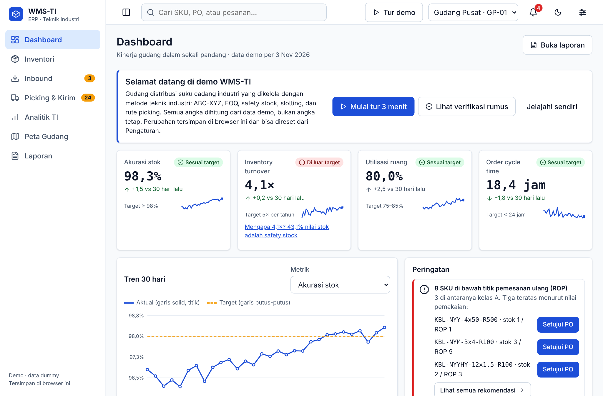
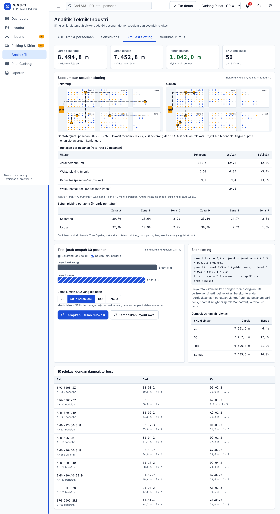
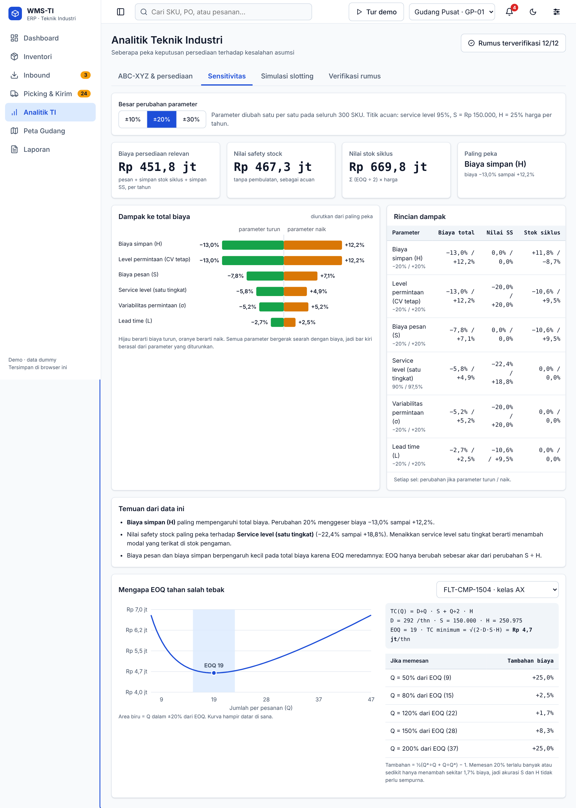

# WMS-TI

Demo manajemen gudang suku cadang industri yang memakai metode teknik industri: klasifikasi ABC-XYZ, EOQ, safety stock, slotting, rute picking, dan cycle counting. Satu file HTML tanpa server dan tanpa framework.

**Demo langsung:** https://rakhanaufal736-cmd.github.io/wms-demo/

> **Ini versi demo.** Semua data adalah data rekaan (300 SKU, 480 lokasi rak, 60 pesanan, 40 PO) dan hanya tersimpan di browser pengunjung. Belum ada login, peran pengguna, basis data bersama, pemindai barcode, atau integrasi ERP. Versi lengkap dapat dikembangkan bila ada kesempatan bekerja sama.



## Masalah yang dijawab

Gudang suku cadang memegang ribuan SKU dengan pola permintaan yang sangat berbeda. Tiga pertanyaan yang diangkat demo ini:

1. **Berapa banyak dan kapan memesan?** Stok terlalu sedikit berpotensi menghentikan proses produksi dan sales, stok terlalu banyak biaya inventory berpotensi membengkak.
2. **Di rak mana barang ditaruh?** Barang yang sering diambil sebaiknya dekat dock dan setinggi pinggang.
3. **Seberapa yakin dengan angkanya?** Rumus bergantung pada asumsi biaya dan lead time, jadi perlu diuji sensitivitasnya.

## Isi aplikasi

| Menu | Kegunaan |
|---|---|
| Dashboard | Tujuh KPI (akurasi stok, turnover, utilisasi, order cycle time, dock-to-stock, perfect order, picks per jam), peringatan SKU di bawah ROP, PO terlambat, rak penuh |
| Inventori | Daftar SKU, status stok, pencarian, rincian per SKU |
| Inbound | Penerimaan barang terhadap PO, lalu putaway ke rak dengan saran lokasi |
| Picking & Kirim | Wave picking dengan urutan rute terpendek, layar picker lengkap dengan peta, konfirmasi pengiriman |
| Analitik TI | ABC-XYZ, EOQ, safety stock, ROP, rekomendasi pemesanan ulang |
| Sensitivitas | Diagram tornado dan kurva biaya EOQ |
| Simulasi slotting | Perbandingan layout sebelum dan sesudah relokasi |
| Verifikasi rumus | Kasus hitung tangan, hitung ulang independen, ekspor CSV untuk dicek silang di spreadsheet |
| Peta Gudang | Utilisasi rak dan kelas ABC per lokasi |
| Laporan | Ringkasan dan ekspor |

Tombol **Tur demo** memandu tujuh langkah (setujui PO, ubah service level, terima barang, putaway, lihat peta, buat wave, terapkan slotting) dan sekitar 3 menit.

## Metode

| Topik | Rumus atau aturan |
|---|---|
| EOQ | Q* = √(2·D·S ÷ H), dengan H = persentase biaya simpan × harga |
| Safety stock | SS = Z · σd · √L, dengan σd = σ bulanan ÷ √30 |
| Titik pesan ulang | ROP = d · L + SS |
| ABC | Kumulatif nilai pemakaian: A sampai 80%, B sampai 95%, sisanya C |
| XYZ | CV = σ ÷ μ (stdev sampel, n−1): X di bawah 0,5, Y sampai 1,0, Z di atas 1,0 |
| Skor slotting | 0,7 × jarak ternormalisasi + 0,3 × penalti ergonomi (level 2–3 = 0, level 1 = 0,5, level 4 = 1,0) |
| Rute picking | Nearest-neighbor, jarak Manhattan, berangkat dan kembali ke dock |
| Waktu picking | jarak ÷ 72 m/menit + 0,63 menit per baris + 2 menit persiapan |
| Cycle count | Bobot kunjungan A:B:C = 4:3:1 |
| Sensitivitas | Parameter diubah satu per satu pada seluruh SKU, dilihat dampaknya ke biaya total, nilai SS, dan stok siklus |

## Hasil pada data demo

Angka berikut dihitung ulang aplikasi dari data seed, bukan angka tetap.

- **Kelas A** berisi 81 SKU (27%) dan menguasai sekitar 80% nilai pemakaian. Matriks ABC-XYZ terisi sembilan sel.
- **8 SKU berada di bawah ROP**, tiga di antaranya kelas A.
- **Slotting:** memindahkan 50 SKU memperpendek total rute 60 pesanan sebesar **12,3%**. Memindahkan 100 SKU memberi 21,2%. Contoh satu pesanan, SO-26-1226, turun dari 225,2 m menjadi 107,6 m. Rata-rata per pesanan, waktu picking turun dari 6,59 ke 6,35 menit karena waktu jalan hanya sebagian dari total waktu.
- **Service level** menentukan modal di stok pengaman: dari 95% ke 99%, nilai safety stock naik dari Rp 895 juta ke Rp 975 juta.
- **Turnover** persediaan berada di sekitar 4,1 kali per tahun, di bawah target 5. Penyebabnya terlihat di aplikasi: 56 SKU kelas Z (permintaan tidak menentu) memegang sekitar 48% nilai stok dengan perputaran sekitar 1,5 kali, sedangkan SKU kelas X berputar sekitar 7 kali.
- **Sensitivitas:** pada pengaturan awal, biaya simpan dan level permintaan paling mempengaruhi biaya total (sekitar −13% sampai +12% untuk perubahan 20%). Nilai safety stock paling peka terhadap service level. Memesan 20% lebih banyak atau lebih sedikit dari EOQ hanya menambah sekitar 1,7% biaya, jadi kurva EOQ tahan terhadap salah tebak biaya.

| Slotting | Sensitivitas |
|---|---|
|  |  |

## Verifikasi

- **12 kasus hitung manual** (EOQ, SS, ROP, ABC, XYZ, rute, dan lainnya) harus cocok dengan hasil fungsi pada program. Hasilnya tampil di menu Verifikasi rumus.
- **Hitung ulang independen** untuk seluruh 300 SKU.
- **Ekspor CSV** berisi rumus spreadsheet (SUM, STDEV, SQRT, ROUNDUP) untuk dibandingkan dengan hasil aplikasi. Perbandingan dengan LibreOffice menunjukkan selisih nol.
- **23 tes otomatis** (`logic.test.js`) mencakup rumus, invarian data setelah rangkaian aksi gudang, determinisme seed, dan elastisitas teoretis (EOQ ∝ √(S÷H), SS ∝ √L).
- Seed deterministik dan memiliki fingerprint, sehingga hasil dapat konsisten di semua browser.

Menjalankan tes: letakkan `logic.js` dan `logic.test.js` dalam satu folder, lalu jalankan `node --test` (Node 18 atau lebih baru).

## Asumsi dan batasan

Bagian ini sengaja ditulis terbuka.

- **Data simulasi, satu pengguna.** Tidak ada backend, autentikasi, atau jejak audit.
- **Waktu picking** memakai kecepatan jalan dan waktu per baris yang diasumsikan, bukan hasil studi waktu.
- **Rute** memakai heuristik nearest-neighbor, bukan solusi optimal. Belum ada batch picking, zone picking, kapasitas troli, atau FIFO/FEFO; tetapi bisa diimplementasikan sesuai kebutuhan. 
- **Permintaan dianggap stasioner.** Belum ada musiman, tren, atau peramalan.
- **Satu nilai biaya pesan dan biaya simpan** dipakai untuk semua SKU, padahal pemasok dan kategori berbeda.
- **Slotting** meminimalkan skor biaya per lokasi. Sebenarnya, skor itu pendekatan terhadap jarak, sehingga memindahkan semua SKU (16,0%) tidak selalu lebih baik daripada memindahkan 100 SKU terpilih (21,2%).
- Pengujian dilakukan di Chrome. Safari dan Firefox belum diuji.

## Cara menjalankan

Buka `index.html` di browser, tanpa instalasi. Untuk menayangkannya, unggah berkas ke repositori publik GitHub dan aktifkan GitHub Pages (Settings, Pages, branch `main`, folder root).

## Struktur

```
index.html        aplikasi lengkap (HTML, CSS, JS dalam satu berkas)
logic.js          logika murni: rumus, seed, aksi gudang (sama dengan yang ada di index.html)
logic.test.js     tes otomatis, dijalankan dengan node --test
docs/             tangkapan layar untuk README
```

## Pengembangan lanjutan

Bila dikembangkan menjadi sistem penuh: basis data dan API, login dengan peran (admin, supervisor, picker), pemindai barcode di layar picker, integrasi ERP, peramalan permintaan, batch dan zone picking, serta studi waktu untuk mengganti asumsi waktu picking; Dikembangkan bila ada kesempatan bekerja sama.
